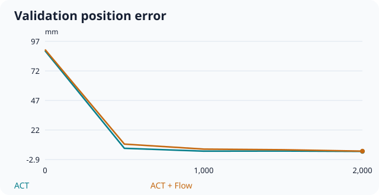
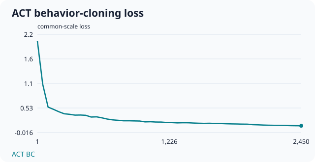
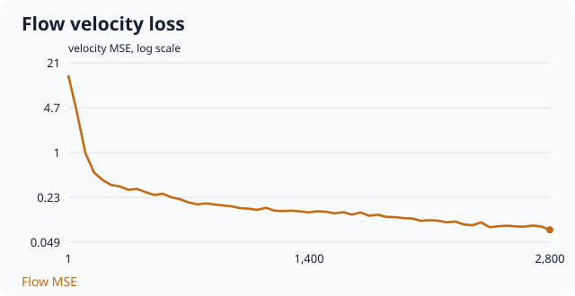

> 持續自動同步尚待電腦完成 GitHub 登入；這份報告已由已連線的 GitHub 更新。

# ACT＋Residual Flow 訓練狀態

**aic_sfp0_alternating_residual_flow_scratch_v1**

**近期有新紀錄** · 完全從零初始化

報告更新：**2026-10-29 17:56:09 UTC+8**  
最後日誌更新：**2026-10-29 17:55:27 UTC+8**

| 進度 | 百分比 | 預估剩餘 |
|---|---|---|
| 2,800 / 10,000 | 28.0% | 約 116 分鐘 |

一個訓練步包含 ACT 與 Flow 各一次更新。固定 VAL：1,500 個窗口。

## 最近一次驗證

| 指標 | ACT 單獨 | ACT＋Flow |
|---|---:|---:|
| 驗證步數 | 2,500 | 2,500 |
| VAL loss | 0.08266 | 0.10963 |
| 三維位置誤差 | 3.050 mm | 3.355 mm |
| 旋轉誤差 | 0.146° | 0.246° |

| 軸向平均絕對誤差 | ACT | ACT＋Flow |
|---|---:|---:|
| X | 1.551 mm | 1.760 mm |
| Y | 1.076 mm | 1.520 mm |
| Z | 1.620 mm | 1.687 mm |

同一步加入 Flow 後，三維誤差增加 **0.305 mm**。

## 訓練 loss

ACT BC：**0.11957** · Flow 速度 MSE：**0.07490**

兩個 loss 定義不同，不能直接比較大小。

## 已保存的 BEST

| 權重 | 步數 | 對應三維誤差 |
|---|---:|---:|
| `best.pt` | 2,500 | 3.355 mm |
| `best_position.pt` | 2,500 | 3.355 mm |
| `best_act.pt` | 2,500 | 3.050 mm |
| `best_act_position.pt` | 2,500 | 3.050 mm |

## 其他紀錄

- ACT LR：8.525354006175926e-06
- Flow LR：2.557606201852778e-05
- 訓練紀錄中的 CUDA 峰值：5.46 GiB

這是定時上傳的快照，手機重新整理即可查看更新。日誌沒有更新不一定代表訓練停止。

這個分支只包含指標與曲線，不包含資料集、模型權重或登入憑證。離線誤差不等於實際插入成功率。
