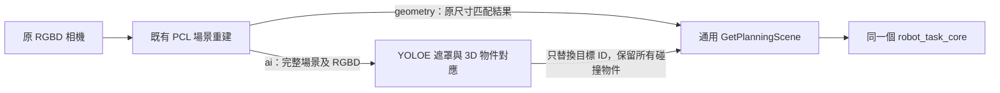
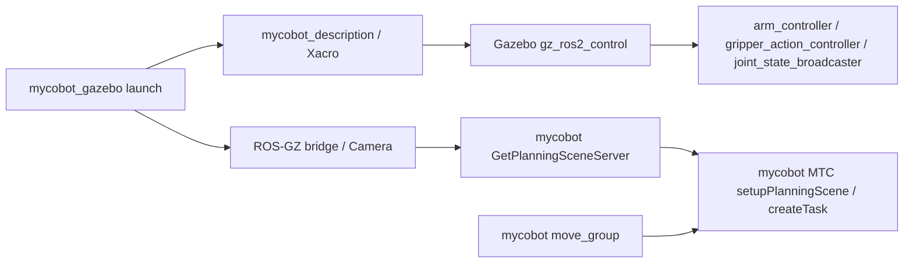
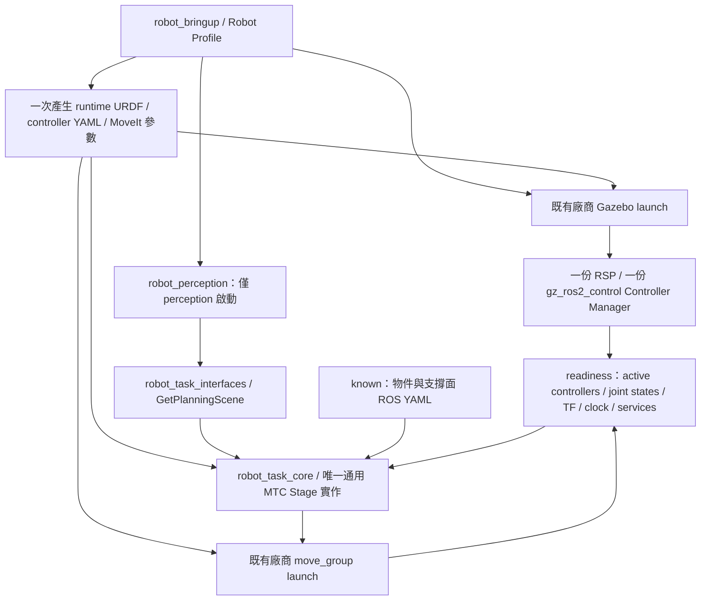

# Robot Task 架構與驗證

目前使用相同的 Profile 契約接入 myCobot 280 與 Kinova Gen3 Lite（6DOF、Gen3 Lite 2F）。
Kinova 透過 `kinova_gen3_lite_support` 提供模型／MoveIt／Gazebo 設定與 Launch wrapper；
初次 Kinova 整合未修改 `robot_task_core`、`robot_perception`、`robot_task_interfaces`。
詳見 [Kinova 整合文件](../src/robot_pick_place/kinova_gen3_lite_support/README.md)。

後續新增可選 YOLOE 目標選擇器：`robot_perception` 內增加 Python 模組，
原本 C++ PCL 演算法、MTC 與服務格式仍沿用。



`perception_method:=geometry` 時僅原 PCL 服務對外提供通用端點。
`ai` 時 PCL 改用私有 `/perception/get_planning_scene/geometry`，
Python 選擇器提供原 `/perception/get_planning_scene`，MTC 不需知道目標是如何選出的。
AI 載入成功才發布服務，readiness 仍等待同一個公開端點；AI 節點退出時停止此次 launch。
可用參數與資料要求見 [AI 辨識模式](ai_perception.md)。

AI 預設為互動模式：`pick_console` 只負責啟動既有 launch、讀取文字及呼叫
`/pick_place/run`（`RunPickPlace`），MTC 保留原 stage 與 execute 邏輯。
MTC 每次請求將 `target_label` 傳至 `GetPlanningScene`，AI 動態更新提示；
幾何後端只在請求後訂閱並擷取新的 RGB／點雲，完成後停止訂閱。
MTC 每次重建 Task，更新自己管理的碰撞物件、保留外部障礙物，並拒絕重疊執行。
`interactive:=false` 保留單次模式，幾何模式仍依原方式啟動。

## Phase 0：基準

起始 Branch：`main`；Commit：`ed37a97` (`Initial ROS 2 workspace`)。
`git status --short` 只有使用者新增的 `src/robot_pick_place/mycobot_ros2/ROBOT_AGNOSTIC_REFACTOR.md`
與 Zone.Identifier；保留不變。

舊流程：



已核對：SRDF `arm`、`gripper`，end effector `gripper`、IK/attach link `link6_flange`，
`base_link`/`world`；姿態 `home`、`open`、`half_closed`。
MoveIt controllers：`arm_controller` (`FollowJointTrajectory`)、
`gripper_action_controller` (`GripperCommand`)；關節名稱與 ros2_control YAML 一致。
舊 Service：`/get_planning_scene_mycobot`，型別 `mycobot_interfaces/srv/GetPlanningScene`。
點雲 `/camera_head/depth/color/points`、影像 `/camera_head/color/image_raw`，TF 至 `base_link`。

主要耦合：固定廠商標頭與 Service Type/Name、MTC 內的預設機器人名稱、Launch 固定
MoveIt Package 與設定路徑、controller template 寫回固定 workspace、無逾時的 Service 等待。
舊 PCL 演算法與 MTC stage 將保留；新套件逐步新增，不先刪除舊來源。

## 新架構與責任



| 項目 | 舊架構 | 新架構 |
|---|---|---|
| 任務 | myCobot Demo 同時包含任務、Client、PCL | `robot_task_core` 僅依賴 ROS/MoveIt/MTC 與通用介面 |
| 感知 | myCobot Package 與 ROSIDL Type | `robot_perception` 與 `robot_task_interfaces`，保留 PCL helpers |
| 機器人設定 | 散落於 Launch 和 C++ 預設值 | Profile → bringup → ROS Parameters；任務中無型號分支 |
| 場景 | 固定呼叫感知服務 | known/perception 建立相同場景，進入同一 `createTask()` |
| 啟動 | 手動分開啟動／舊 script 的固定 sleep | 單一 Launch，使用有逾時的 readiness，控制器 spawner 等待 manager |
| MoveIt 設定 | 各 Launch 自行建立 | 新入口建立一次，URDF 原文同時傳給 RSP、move_group、MTC |
| Controller YAML | Launch 寫回固定 workspace 的 source/install | Package Share 範本 → 獨立 runtime 目錄 → Xacro plugin 使用同一路徑 |
| 執行預設 | 舊 YAML `execute: true` | **新入口預設 `execute=false`**；舊 YAML 預設未改 |

通用套件的 CMake、package.xml、標頭及 Launch 均不依賴 `mycobot_*`。
只有整合層 `robot_bringup` 引用機器人後端。原 MTC 與感知來源保留供對照，
尚不刪除；新流程不執行舊 MTC 或舊感知節點。

通用感知 Service 使用 `/perception/get_planning_scene`，型別為
`robot_task_interfaces/srv/GetPlanningScene`。MoveIt 已使用 `/get_planning_scene`
與自己的 `moveit_msgs/srv/GetPlanningScene`，因此特意分開命名，避免同名不同型別。
Client/Server 的預設值一致，亦可由 Profile 的 `perception.service_name` 覆寫。
舊 Service `/get_planning_scene_mycobot` 與 `mycobot_interfaces` 保留不變。

## 安裝、建置與啟動

環境為 Ubuntu 24.04、ROS 2 Jazzy、Gazebo Harmonic。若是新環境，先依 ROS 官方方式安裝
Jazzy、`python3-colcon-common-extensions` 與 `python3-rosdep`；僅第一次使用 rosdep 時執行
`sudo rosdep init`，然後 `rosdep update`。在本儲存庫中包含 `src/` 的根目錄：

```bash
source /opt/ros/jazzy/setup.bash
rosdep install --from-paths src --ignore-src -r -y
colcon build --symlink-install
source install/setup.bash

ros2 pkg prefix robot_task_interfaces
ros2 pkg prefix robot_perception
ros2 pkg prefix robot_task_core
ros2 pkg prefix robot_bringup
ros2 launch robot_bringup demo.launch.py --show-args
```

無須以 `ros2_ws` 命名 workspace，也不必把廠商套件移出既有目錄。MTC/PCL 依賴由 rosdep
解析，不把第三方來源複製進本專案。記憶體較少時可用
`CMAKE_BUILD_PARALLEL_LEVEL=2 MAKEFLAGS=-j2 colcon build --symlink-install --parallel-workers 2`。

新入口沿用原本的相機感知與 MTC 流程，只需要一個啟動終端：

```bash
source /opt/ros/jazzy/setup.bash
source install/setup.bash
ros2 launch robot_bringup demo.launch.py robot:=mycobot_280 execute:=false
# 可選的已知物件規劃測試：
ros2 launch robot_bringup demo.launch.py robot:=mycobot_280 scene_source:=known execute:=false
# 無 GUI 時加上：headless:=true use_rviz:=false
# 確認規劃、場景、碰撞及控制器後才測試：execute:=true
```

另一個終端 source 相同環境後：

```bash
ros2 control list_controllers
ros2 topic echo /joint_states --once
ros2 topic list
ros2 service list -t
ros2 action list -t
ros2 node list
```

預期三個 Controller 為 active，且 `/joint_states`、TF、`/clock` 有資料；只有一份
`/move_group`、`/robot_state_publisher`、`/controller_manager`。known 不啟動相機或
感知 Server；perception 額外等待非空 PointCloud2/RGB Image 與通用感知服務。
感知失敗或場景套用失敗時，MTC 不規劃；任務錯誤以非零 exit code 結束。
Controller ListControllers 每筆回覆最多等待 3 秒，逾時取消該筆 pending request 後重試，
避免開機早期某筆回覆未抵達時一直卡住；全部控制器 active 的條件與全域 readiness timeout 保留。

## Launch 參數與場景

| 參數 | 新入口預設 | 用途 |
|---|---|---|
| `robot` | `mycobot_280` | installed Profile ID；未知名稱明確報錯 |
| `profile` | 空 | 外部 Profile YAML；robot_id 必須與 robot 相同 |
| `scene_source` | `perception` | 原本感知流程；`known` 為可選規劃測試 |
| `execute` | `false` | true 時規劃成功後檢查 active controllers 與 action availability |
| `use_sim_time` | `true` | 一致傳入 RSP、MoveIt、MTC、感知與 readiness |
| `use_rviz` | `true` | MoveIt RViz；Gazebo include 的 RViz 關閉以避免重複 |
| `headless` | `false` | Gazebo `-s --headless-rendering`；相機仍需要可用的 EGL/Ogre2 |
| `use_camera` | 自動 | known=false、perception=true；不一致則拒絕 |
| `world_file` | Profile 值 | 後端 package 的 world resource 名稱 |
| `service_timeout` | `30.0` | 感知服務可用與回覆各自的等待上限（wall time） |
| `readiness_timeout` | `120.0` | 控制器、狀態、TF、時鐘、場景服務的總等待上限 |
| `task_params_file` | 空 | 單一節點 ROS YAML，覆寫場景/任務參數；安全執行與模式仍由 Launch 決定 |

已知場景位於 `robot_bringup/config/scenes/mycobot_known.yaml`，可複製成 ROS YAML 後以
`task_params_file:=/path/to/scene.yaml` 覆寫。物件為 CYLINDER `[height,radius]`，BOX 為
`[x,y,z]`；Pose 支援 `[x,y,z,roll,pitch,yaw]`（ROS 固定軸 RPY）或
`[x,y,z,qx,qy,qz,qw]`（有限數值、單位四元數）。物件 Pose 是**中心**，不是底面。

已核對 Gazebo world 中圓柱中心 `[0.22,0.12,0.175]`、長度 `0.35`；SDF 視覺半徑
`0.0125`、碰撞半徑 `0.015`。known 使用碰撞半徑；perception 保留舊辨識半徑 `0.0125`。
已知支撐面為可調的有限 pickup ground patch，表面 z=0，避免把向 base_link 原點下方延伸的
機器人底座誤判成埋入完整地板。這是規劃測試場景，未重建世界中其餘所有物件。

Profile 的 spawn z=0 與舊 `robot.sh` 相同，讓此範例的 URDF world/base 與物件 world 對齊；
單獨的原 Gazebo Launch 仍保留 z=0.05 預設。若改 spawn xyz/rpy，必須同步處理真實 TF 與
物件座標，不能只更改 Gazebo 位姿而讓 URDF 的 world→base 固定轉換維持不變。
放置目標保留原本 `[-0.183,-0.14,0,...]`；`place_pose` 的 z 是支撐高度，依放置方向的
物件投影高度乘以 `place_pose_z_offset_factor`（預設 0.5）補上中心高度。

MTC 的 Stage 順序與 OMPL / Cartesian / JointInterpolation 用法保持。
唯一必要的接觸修正：SRDF 只列主動夾爪關節時，也從 RobotModel 追蹤其 mimic joints 與
後代碰撞 Link，對同一組手指在抓取時允許目標接觸、放置時恢復碰撞檢查。未停用整體碰撞檢查，
未更改 URDF/SRDF、夾爪關節限制或命名姿態。

## Profile schema v1 與後端契約

實際範例：`src/robot_pick_place/robot_bringup/config/robots/mycobot_280.yaml`。
`robot_bringup.profile` 驗證欄位、套件資源、SRDF Group/End Effector/姿態、Controller 名稱
與關節對應；`configuration` 再產生 URDF，核對 Frame/Joint，建立一次共用 MoveIt 設定。
C++ MTC 只收到標準 ROS Parameters，不直接解析 Profile。

| 區塊 | 必要內容 |
|---|---|
| `schema_version`, `robot_id` | version=1；ID 與 robot Launch Argument 一致 |
| `simulation` | `package`, `launch_file`, `world_file`, `arguments` |
| `robot_description` | `package`, `launch_file`, `xacro_file`, 字串 mapping 字典 |
| `moveit` | `package`, `launch_file`, `config_argument`, `robot_name`, 明確資源 `files` 與 `pipelines` |
| `moveit.files` | semantic、kinematics、joint_limits、controllers、ros2_controllers、controllers_template、cartesian_limits 的 package-relative 路徑 |
| `planning` | arm_group、gripper_group、end_effector、ik_frame、base_frame、home/open/close_pose、grasp_frame_transform、pipeline、planner_id |
| `execution` | controller_manager、state_controller、arm_controller、gripper_controller、gripper_strategy |
| `perception` | point_cloud_topic、rgb_image_topic、target_frame、service_name、`params: {package,file}` |
| `scene` | known/perception 各自 `{package,file}` 指向單一節點 ROS YAML |

不假設 `config/<robot_name>/...` 結構；每一個設定路徑都由 Profile 指定。
Package Resource 禁止 `~`、絕對路徑與 `..`；外部 Profile 和 ROS override 檔可由使用者給定
完整路徑。Controller template 只替換 Profile mappings 對應的 `${key}`；不重寫程式碼。

目前後端契約：simulation launch 負責 Gazebo、一次 RSP、一次 Controller Manager 與
Controller 啟動，接收 `robot_description_file`、`controllers_file`、`headless`、`use_camera`、
`use_sim_time`、`world_file`、`load_controllers`、`use_robot_state_pub`、`use_rviz` 及 spawn 參數。
`robot_description.launch_file` 指出該後端內部包含的 RSP 入口，由後端啟動一次；整合層不再重複啟動。
MoveIt launch 必須支援 `config_argument` 指出的參數（本後端為 `moveit_config_file`），讀取
整合層產生的完整設定字典，並接收 use_sim_time/use_rviz；不另外再建立另一個 move_group。
不符合此參數契約的廠商套件，需要一個小型 Launch wrapper，無須修改 MTC。

SRDF 亦須有涵蓋 arm 與 gripper 主動關節聯集的群組（兩個現有後端皆為
`arm_with_gripper`）。MTC Connect 會合併兩組軌跡，ExecuteTaskSolution 需要找到能表示
這組關節的 JointModelGroup；只有獨立的 arm、gripper 可通過規劃，但會在實際執行時被拒絕。

目前 `gripper_strategy=named_pose`：使用 MTC MoveTo / JointInterpolation 與 SRDF 命名姿態；
MoveIt Simple Controller Manager 映射 arm 的 FollowJointTrajectory 與夾爪的 GripperCommand。
其他 Action 型別需 Controller/Action adapter，並在 Profile/MoveIt controller config 明確描述；
程式遇到未支援策略或型別會拒絕，不能只改 Controller 字串便聲稱支援。

## 舊入口相容性

以下舊入口保留，請與新 demo **擇一使用**，不要對同一機器人同時啟動兩套 RSP/MoveIt/Controller：

```bash
# 終端 1（無 GUI 可額外 headless:=true）
ros2 launch mycobot_gazebo mycobot.gazebo.launch.py \
  load_controllers:=true world_file:=pick_and_place_demo.world use_camera:=true \
  use_rviz:=false use_robot_state_pub:=true use_sim_time:=true
# 終端 2
ros2 launch mycobot_moveit_config move_group.launch.py \
  rviz_config_file:=mtc_demos.rviz rviz_config_package:=mycobot_mtc_demos
# 終端 3
ros2 launch mycobot_mtc_pick_place_demo get_planning_scene_server.launch.py
# 終端 4（保留原 YAML execute:true；執行前自行核對）
ros2 launch mycobot_mtc_pick_place_demo pick_place_demo.launch.py
```

新舊 Service Type 不能混用。舊 Demo 的來源、演算法與 execute 預設保留作為回歸對照；
新服務不能直接取代舊 Client 的 server。舊 `robot.sh` 依規格保留，但含廣泛 pkill；
建議使用新的統一 Launch。新流程與測試器只管理自己啟動的程序。

## 新增另一機器人的驗證順序

1. 安裝其 Description / MoveIt / Gazebo / ros2_control 套件；不複製本任務程式。
2. 建立新的 Profile，提供明確的資源路徑與相容的 simulation/MoveIt launch，必要時用小型 Launch wrapper。
3. 核對 SRDF Groups、end_effector、IK frame、命名姿態、TCP/抓取轉換及 IK solver。
4. 核對 Controller 名稱、關節清單與 Action Type；不同夾爪策略先實作 adapter，再設定 Profile。
5. 核對 world/base/spawn、物件中心、支撐面、相機安裝、topics 與 TF；先 known、execute=false，再 perception。
6. 驗證模型、控制器、Joint States、TF、碰撞、完整規劃，最後才 execute=true 與 Gazebo 物理夾持。

證據：`robot_task_core` 的 manifest/CMake/標頭/Launch 不含任何 mycobot Package 依賴；
`createTask()` 沒有 robot 型號條件，兩種場景來源共用它。未來新增 Profile/Launch/adapter
不需要複製或重編譯 Stage；其他機器人是否能執行仍需實際整合驗證。

## 排錯與限制

- `PackageNotFoundError` 或資源不存在：先 source 正確的 install/setup.bash，檢查 Profile 的 package/file；錯誤會指出欄位。
- Frame/TF：核對 SRDF、URDF、相機 target_frame、spawn 與 use_sim_time；readiness 會列出缺失的 TF/clock。
- Controller inactive：查 controller_manager、Gazebo plugin 與 runtime YAML 日誌；spawner 有等待上限，失敗停止啟動。
- Service timeout：確認 scene_source 與 service_name、Service Type、點雲/RGB 資料及 TF；known 完全不建立 perception client。
- IK/規劃失敗：查載入的 arm Group、kinematics solver、TCP、物件尺寸/中心、支撐面及 MTC 失敗 Stage。
- Ogre2/EGL：headless 只關閉 Gazebo GUI，不會免除感知相機的渲染需求。
- `execute=false` 不呼叫 `task.execute()`；控制器可以維持模擬初始姿態，但不會下發 MTC 軌跡。
- MoveIt Attach 僅改 Planning Scene；Gazebo 真正夾持需要另驗證接觸、摩擦或物理附著，這次不加入新的附著外掛。

具體 Passed / Failed / Not Tested 與環境問題見 [validation.md](validation.md)。

### 本次 Place IK 的必要修正

放置 IK 使用 attached object frame，讓目標姿態與實際抽樣後的抓取關係一致；
GeneratePlacePose 的輸出與物件 Frame 語意可對照
[官方 GeneratePlacePose 原碼](https://github.com/moveit/moveit_task_constructor/blob/ros2/core/src/stages/generate_place_pose.cpp)。
放置高度投影的旋轉矩陣改用明確 `Eigen::Matrix3d` 值，避免 `auto` 保留對暫存 Isometry
的參考。原放置 xyz/rpy 未改；圓柱中心目標應是 `[-0.183,-0.14,0.175]`。

Launch 先把預設 YAML 與 Profile/場景覆寫合成同一個參數字典，再傳給 MTC，
避免節點專屬 YAML 與 wildcard 參數的優先權把 scene_source/execute 蓋回預設。
後續依使用者要求，新入口預設改回 `perception`，沿用原本的感知流程；`known` 保留為可選測試。
啟用相機的共用 URDF 包含固定相連的 `torso_link` 與 `camera_head_link`，其安裝幾何重疊；
myCobot 的 SRDF 補上這一對 Adjacent 碰撞排除。這是機器人設定，不在共用 MTC 寫入型號判斷。
