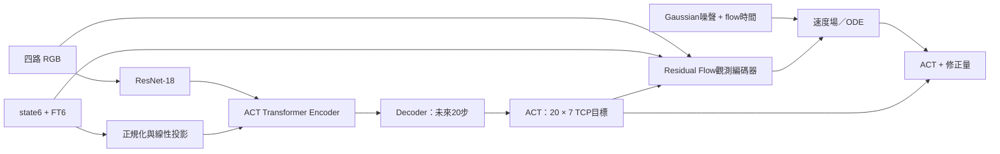

# 架構、資料語意與程式分工

任務固定為 `sfp_tip → nic_card_mount_0/sfp_port_0`，20 Hz，四路 RGB＋state＋FT，
輸出未來 20 步、每步 7 維的絕對 TCP 目標：`base_link` 下 xyz＋xyzw。



ACT 使用 model dim 512、8 heads、4 encoder／1 decoder、FFN 3200、ResNet-18。
目前是 deterministic ACT，z=0，沒有 CVAE／KL；所以不能宣稱完整重現原 ACT 的所有訓練元件。
四路影像在單個模型內共用 backbone；ACT 與 Flow 各自有觀測編碼器。

## state 與 action 的實際意義

為相容既有記錄，`observation.state` 六維順序是：

```text
elbow_joint, gripper/left_finger_joint, shoulder_lift_joint,
shoulder_pan_joint, wrist_1_joint, wrist_2_joint
```

它是五個手臂關節加夾爪，**不是完整六軸關節向量**，缺少 wrist_3。
原始資料另存 `observation.arm_joint_positions` 與實測 `observation.tcp_pose`，目前模型沒有直接輸入它們。
如果改 state 語意，收集／cache／normalizer／推理必須一起更新，舊權重不能無條件混用。

action 是控制器送出的 TCP **目標**，不是實測 TCP，也不是接頭到孔的真值距離。
接觸／插入後，控制器可能繼續降低 Z 目標維持施力，實際 TCP 幾乎不動。
目前「直接成功」篩選使用控制器種類與官方成功評分，未自動裁掉成功事件後片段；
因此成功 episode 的每一列不一定都是相同價值的精準插入監督。

## Loss 與殘差

ACT loss：

```text
(3/7) × mean(abs(predicted_xyz - expert_xyz) / 0.01m)
+ (4/7) × normalized_quaternion_L1
```

XYZ 使用同一實際尺度，不因各軸標準差不同而讓 Z 變得便宜。
VAL 另外以公尺／mm／cm 和四元數角度計算實際預測誤差。

Residual Flow：

```text
r* = (normalized_expert_action - normalized_frozen_ACT_action) / λ
ε ~ Normal(0,I), τ ~ Uniform(0,1)
xτ = (1-τ)ε + τr*
loss = mean((vθ(xτ,τ,observation,ACT_action) - (r*-ε))²)
```

目前 λ=1、sigma_min=0、Euler 10 步，最後四元數正規化。
兩階段流程的 ACT 全程 no-grad／eval，Flow 梯度不會更新 ACT。
參考 [Flow Matching](https://arxiv.org/abs/2210.02747) 與 [ACT–Flow 成功動作監督／殘差重標記](https://arxiv.org/html/2610.29117v2#S4.SS1)。
這裡沒有 critic、候選價值加權、線上 RL；不能宣稱完整重現 ACT–Flow。

## 程式分工

| 範圍 | 檔案 |
|---|---|
| 現行入口與路由 | `robot.py`、`scripts/train_sfp0_act_direct.py`、`scripts/train_sfp0_flow_recovery.py` |
| 資料收集 | `collect_sfp0_direct.py`、`collect_sfp0_expert.py`、`collect_sfp0_sideview.py`、`policies/CollectSFP.py`／`AutoExpertFTACT.py` |
| 記錄／官方匯入 | `sideview_recorder.py`、`sideview_writer.py`、`sideview_data.py`、`human_dataset.py`、`expert_batch.py` |
| 篩選與固定快照 | `prepare_sfp0_direct_act.py`、`prepare_sfp0_recovery.py`、`prepare_expert_only.py`、`prepare_sfp0_act_multiview.py` |
| 模型與訓練 | `act_multiview.py`、`residual_flow_multiview.py`、`flow_multiview.py`、`train_sfp0_act_multiview.py` |
| 目標／取樣 | `act_objectives.py`、`idle_sampling.py`、`rollout_sampling.py`、`flow_matching.py` |
| 推理控制 | `run_sfp0_multiview_gazebo.py`、`policies/FTACT.py`、`ftact_control.py`、`multiview_control.py` |
| 評估核心 | `evaluate_sfp0_pace.py`（名稱歷史保留，實際共用 ACT／Flow／PACE） |
| 共用基底／舊權重相容 | `ftact.py`、`ftact_v2.py`、`train_ftact.py`、`train_sfp0_act.py` 等 |

舊名稱不等於未使用。這些基底模組仍提供 normalizer、LR、游標、checkpoint 讀取或舊格式載入能力，
清理時保留其 import 路徑。測試使用小型模型／假 ROS，完整端到端成功率仍需 Gazebo 實測。
